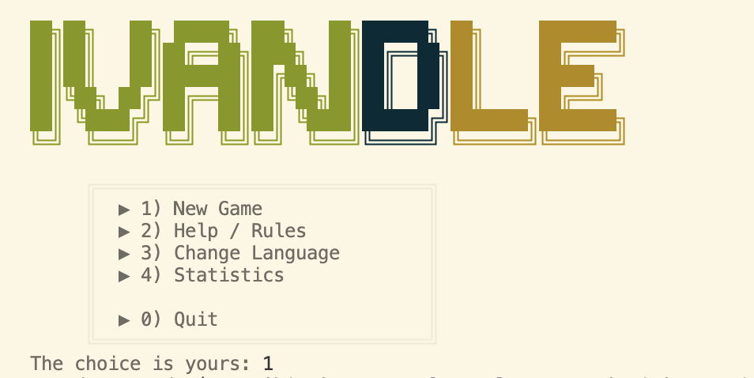
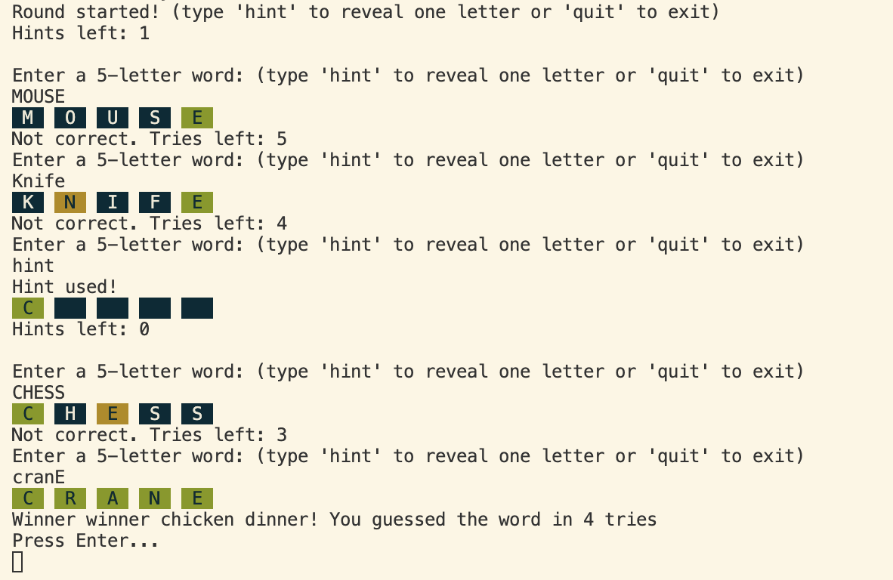
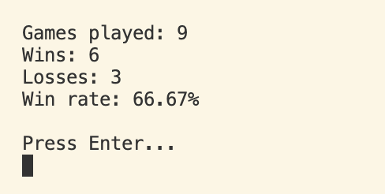

# IVANDLE – Game Manual

## 1. Introduction

Thank you for playing IVANDLE!

IVANDLE is a console-based word guessing game created by Ivan
Pereverziev, inspired by the popular game Wordle, originally
created by Josh Wardle and later acquired by The New York Times.

This project is my own interpretation of the Wordle concept,
implemented in Java as part of a university programming assignment.

The goal of the project was to recreate the core gameplay
mechanics of Wordle while adding my own design, features,
and improvements suitable for a console application.

## 2. How to Play

1. Start the game.
2. Choose the game language.
3. From the main menu, select New Game.
4. Enter a 5-letter word.
5. After each guess, the game will display coloured tiles
   indicating how close your guess is.
6. Continue guessing until you guess the word correctly
   or run out of attempts.
7. Type `quit` to exit the round.

## 3. Rules

- The secret word is randomly selected at the start of each round.
- The secret word is always 5 letters long.
- You have 6 attempts to guess the word.
- Only letters from the selected language's alphabet are allowed.
- Each guess must be exactly 5 letters.
- Invalid input does not consume an attempt.

### Colour Meaning

- 🟩 Green — Correct letter in the correct position
- 🟨 Yellow — Correct letter in the wrong position
- ⬜ Gray — No remaining match for the letter

## 4. Controls & Commands

| Command | Action |
| --- | --- |
| 5-letter word | Make a guess |
| `hint` | Reveal one correct letter |
| `quit` | Exit the current round |

One hint is available per round.

## 5. Language Support

IVANDLE supports three languages:

- English
- Українська (Ukrainian)
- Русский (Russian)

Language selection affects the word pool and allowed alphabet
characters.

The user interface remains in English to keep the game
consistent and readable.

## 6. Extra Features

- Hint system
- Custom ASCII art and visual design
- Animated output using timed delays
- Input validation and error handling
- Repeated letter handling
- Game statistics including games played, wins, losses
  and win rate

## 7. Installation & Running

Requirements:

- Java Development Kit (JDK 21 recommended)
- Terminal supporting ANSI colours and UTF-8

Compile:

```bash
javac -encoding UTF-8 -d bin src/ivandle/*.java
```

Run:

```bash
java -cp bin ivandle.GameMain
```
## 8. Screenshots

### Main Menu
<p align="center">

</p>

### Gameplay
<p align="center">

</p>

### Statistics
<p align="center">

</p>